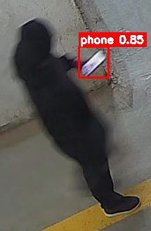
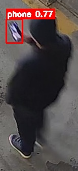
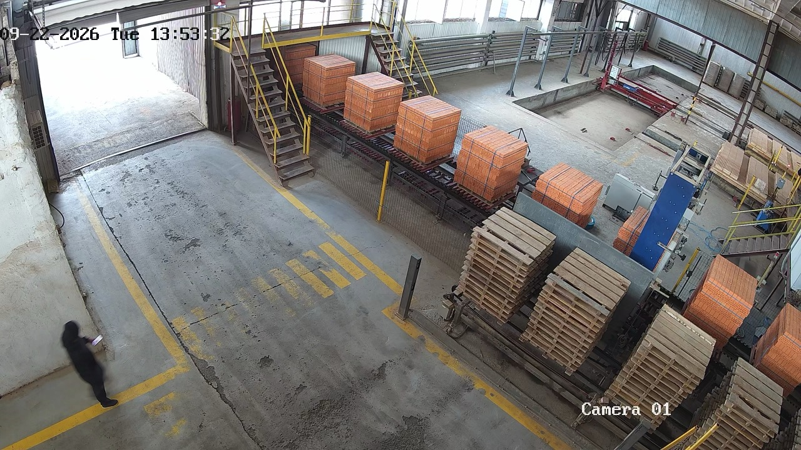
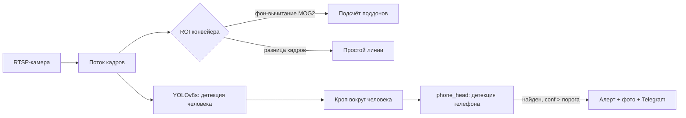

# 🏭 Factory Monitor

Компьютерное зрение для мониторинга цеха по видеопотоку с обычной IP-камеры (RTSP).
Система работает на реальном производстве: считает поддоны на конвейере, следит за простоем линии
и ловит нарушения — использование телефона сотрудниками в рабочей зоне, с уведомлением в Telegram.

<p align="left">
  
  
  
  
  
</p>

## 🎥 Детекция в деле

Реальные кадры с цеха: кастомная модель находит телефон в руке сотрудника и вырезает его силуэт —
лицо и личность не идентифицируются (см. «Приватность» ниже).

<p align="center">
  
  
</p>

<p align="center"><sub>Полный кадр с конвейером, по которому калибровалась зона детекции (ROI):</sub></p>

<p align="center">
  
</p>

## Что делает система

- 📦 **Подсчёт поддонов** — отслеживает прохождение поддонов через зону конвейера (фон-вычитание MOG2 по ROI)
- ⏱ **Простой линии** — если в рабочей зоне нет движения дольше заданного времени, фиксирует простой
- 📱 **Детекция телефона** — двухступенчатый каскад YOLO: сначала находит человека, затем ищет телефон в увеличенном кропе вокруг него
- 🔔 **Алерты в Telegram** — при нарушении рассылает подписчикам бота фото нарушителя и фото всего кадра
- 🖥 **Headless-режим** — работает без дисплея на заводском сервере по SSH, не теряя функциональности
- 🔤 **Кириллица на видео** — собственный рендер текста поверх кадра (OpenCV не умеет кириллицу из коробки)

## Как это устроено



**Почему каскад, а не одна модель на весь кадр.** Телефон в руке занимает считаные пиксели
на кадре 2560×1440 — прогон одной моделью по всему кадру либо теряет такие мелкие объекты, либо
требует огромного `imgsz`. Вместо этого сначала лёгкая и надёжная COCO-модель находит людей
на полном кадре, а затем телефон ищется уже в увеличенном кропе вокруг каждого человека —
это кратно поднимает эффективное разрешение объекта и точность детекции.

**Модель телефона** (`models/phone_head.pt`) дообучена на датасете FPI-Det + реальных кадрах
с этой камеры (hard negatives — силуэты, засветка, движение), чтобы снизить количество ложных
срабатываний именно в условиях конкретного цеха.

## Структура проекта

```
camera-botest/
├── main.py                  # точка входа: python3 main.py
├── app/
│   ├── factory_monitor.py   # основной цикл: ROI-логика, каскад детекции, алерты
│   ├── camera.py            # подключение к RTSP-потоку, чтение в отдельном потоке
│   ├── telegram_bot.py      # регистрация подписчиков и рассылка уведомлений
│   └── text_overlay.py      # рендер кириллического текста поверх кадра (PIL)
├── scripts/
│   ├── live_view.py         # просмотр сырого RTSP-потока без детекции
│   └── test_connection.py   # проверка подключения к камере, сохранение снапшота
├── models/
│   ├── yolov8s.pt            # детекция человека (предобученная COCO)
│   └── phone_head.pt         # своя модель детекции телефона
├── docs/images/              # скриншоты для README
└── requirements.txt
```

## Установка

```bash
git clone https://github.com/abbbrrdev/botest-camera.git
cd botest-camera
pip3 install -r requirements.txt
```

## Настройка

Камера подключается по RTSP. Пароль камеры передаётся через переменную окружения (не хранится в коде):

```bash
export CAM_PASS="пароль_камеры"
# опционально, если отличаются от значений по умолчанию:
export CAM_IP="192.168.1.12"
export CAM_USER="admin"
export CAM_CHANNEL="101"
```

Для уведомлений в Telegram — токен бота (получен у [@BotFather](https://t.me/BotFather)), тоже через переменную окружения:

```bash
export TELEGRAM_BOT_TOKEN="токен_бота"
```

Без этой переменной скрипт работает как обычно, просто без Telegram-уведомлений. Чтобы начать получать
уведомления, нужно написать боту `/start` — chat_id сохранится в `registered_users.json` автоматически
(файл не входит в репозиторий, создаётся при первом запуске).

## Запуск

```bash
python3 main.py
```

Требует, чтобы машина, на которой запускается скрипт, была в одной сети с камерой (либо имела к ней сетевой доступ).

По умолчанию открывается окно live-просмотра. На headless-машине (сервер без дисплея, работа только по SSH)
окно нужно отключить:

```bash
export SHOW_WINDOW=0
python3 main.py
```

Детекция, алерты и Telegram-уведомления работают одинаково в обоих режимах — окно влияет только на
визуальный просмотр.

Вспомогательные скрипты для диагностики камеры:

```bash
python3 scripts/test_connection.py   # проверка подключения, сохранение тестового кадра
python3 scripts/live_view.py         # просмотр сырого потока без детекции
```

## Приватность

`phone/` — директория, куда система автоматически сохраняет фото зафиксированных нарушений
(для отправки в Telegram и разбора инцидентов). Она **намеренно исключена из репозитория**
(`.gitignore`) — в ней оказываются фото сотрудников. Два примера в этом README отобраны
вручную: на них не видно лица — только силуэт в капюшоне против света, человек не идентифицируется.

## Ограничения

- Телефон детектится надёжно, когда физически виден на пикселях (нормальное освещение, не чистый
  силуэт против света, нет смаза движения). Это ограничение самой картинки, а не модели — на
  контровом свете объект не резолвится в принципе.
- ROI конвейера и пороги подсчёта поддонов откалиброваны под конкретный угол установки этой камеры —
  при переносе на другую точку их нужно будет подобрать заново.
